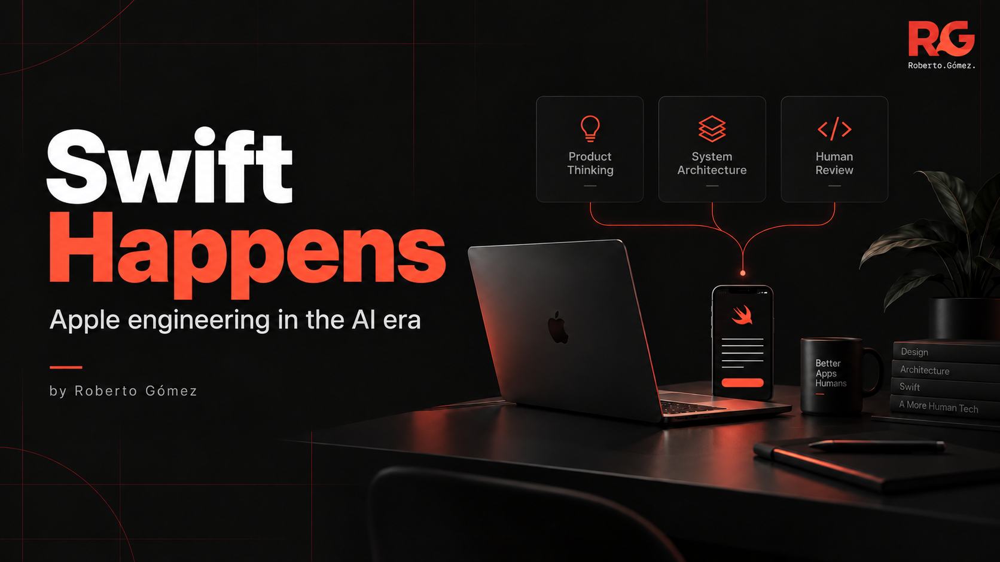

# 👋 Roberto Gómez

**📱 Senior Freelance iOS Engineer · Swift, Apple platforms & AI-assisted development**

I help teams build, modernize, and scale iOS products — and make complex codebases easier to keep evolving.

I have 12+ years of experience, including work on international apps used by millions of people. Previously at **MEGA Cloud Services**, now working freelance from Spain.

I like the part of engineering where product needs meet technical decisions: choosing boundaries, making state predictable, tracking down a difficult bug, and leaving the code easier to change.

[🌐 Portfolio](https://robertogomez.dev) · [💼 LinkedIn](https://www.linkedin.com/in/rgmez) · [✍️ Swift Happens](https://www.linkedin.com/newsletters/swift-happens-7459996990664511488/) · [📬 Email](mailto:rob.gomez.mu@gmail.com)

## 🛠️ How I approach the work

- 🧱 **Architecture that supports delivery.** Clear responsibilities, useful module boundaries, and changes that can ship incrementally.
- 🧪 **Behavior you can trust.** Explicit state, deliberate concurrency, and tests that protect meaningful product behavior.
- ♿ **Accessibility throughout development.** Semantics, focus, and interaction belong in the implementation decisions.
- 🤖 **Automation with clear responsibilities.** I use AI coding tools with explicit context, bounded scope, and review. Product trade-offs and architectural decisions stay with the people responsible for the software.

My work centers on **Swift, SwiftUI, and UIKit**, with a growing focus on modularity, developer tooling, and reusable skills for coding agents.

## 📦 Things I've made public

These projects turn recurring engineering problems into resources other developers can use.

| Project | The problem it helps solve |
| --- | --- |
| 🔄 [ViewStateKit](https://github.com/rgmez/ViewStateKit) | Modeling loading, empty, and error states consistently in SwiftUI and UIKit. |
| ♿ [Apple Accessibility Skills](https://github.com/rgmez/apple-accessibility-skills) | Finding accessibility issues in SwiftUI, UIKit, and AppKit, with prioritized fixes and manual checks. |
| 💬 [Swift Comments That Matter](https://github.com/rgmez/swift-comments-that-matter) | Preserving intent, invariants, side effects, and concurrency risks in documentation that remains useful. |
| 🧩 [Design Patterns in Swift](https://github.com/rgmez/Design-Patterns-in-Swift) | Understanding design patterns through practical Swift implementations. |

## ✍️ Swift Happens

I write about Apple engineering, product judgment, and AI-assisted development, drawing on the trade-offs of real software.

A few starting points:

- [Swift Happens: Thinking Out Loud About Apple Development in the AI Era](https://www.linkedin.com/pulse/swift-happens-thinking-out-loud-apple-development-ai-era-g%C3%B3mez-kjiye)
- [Accessibility is not a final pass](https://www.linkedin.com/pulse/accessibility-final-pass-roberto-g%C3%B3mez-lz3ze)
- [What AI review should never decide](https://www.linkedin.com/pulse/what-ai-review-should-never-decide-roberto-g%C3%B3mez-vopme)

## 🤝 Work with me

Building an iOS product, modernizing an existing app, or working through a codebase that has become hard to evolve? Tell me what you're building and where you're stuck.

[📬 Start a conversation](mailto:rob.gomez.mu@gmail.com) · [💼 Connect on LinkedIn](https://www.linkedin.com/in/rgmez)
